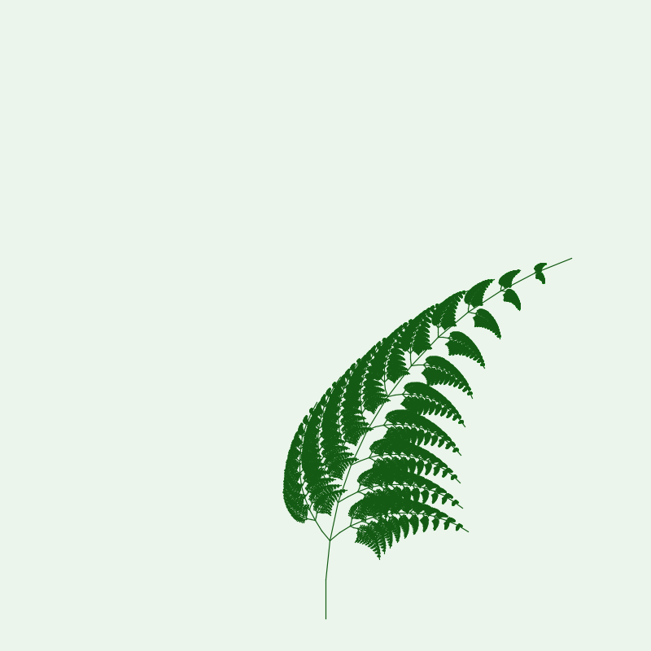

# Дополнительная лабораторная работа №2

## Задача 1. Рекурсия и фракталы. Рекурсивное рисование папоротника

Программа рисует лист папоротника в окне. Глубину рекурсии пользователь задаёт
в поле «Глубина рекурсии» (от 1 до 4). При изменении значения рисунок сразу
перерисовывается.



## Идея решения

Лист состоит из главного стебля, который построен из нескольких отрезков и
постепенно загибается. В точках вдоль стебля выпускаются два боковых листочка.
Каждый боковой листочек — это такой же папоротник, но меньшего размера, поэтому
для него вызывается та же самая функция с параметром `depth - 1`.

Когда `depth` становится равным нулю, рисуется маленький конечный листочек и
рекурсия заканчивается.

Основные параметры:

- `BRANCHES` — количество точек вдоль главного стебля;
- `CURVE` — насколько стебель загибается к концу;
- `SPREAD` — угол, под которым растут боковые листочки;
- `RATIO` — длина бокового листочка относительно длины стебля.

Глубина ограничена четырьмя: количество отрезков растёт экспоненциально, и при
больших значениях рисунок строился бы слишком долго.

Готовые коллекции JDK не используются: только рекурсия и стандартная графика
Java (`Graphics2D`).

## Запуск

```bash
javac -encoding UTF-8 -d out src/*.java
java -Dfile.encoding=UTF-8 -Dstdout.encoding=UTF-8 -cp out Main
```

В PowerShell:

```powershell
java -Dfile.encoding=UTF-8 -Dstdout.encoding=UTF-8 -cp out Main
```

После запуска откроется окно. Глубину рекурсии можно менять в верхней части
окна; рисунок перерисовывается автоматически.
